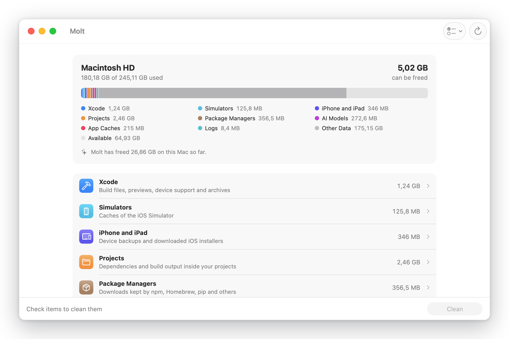
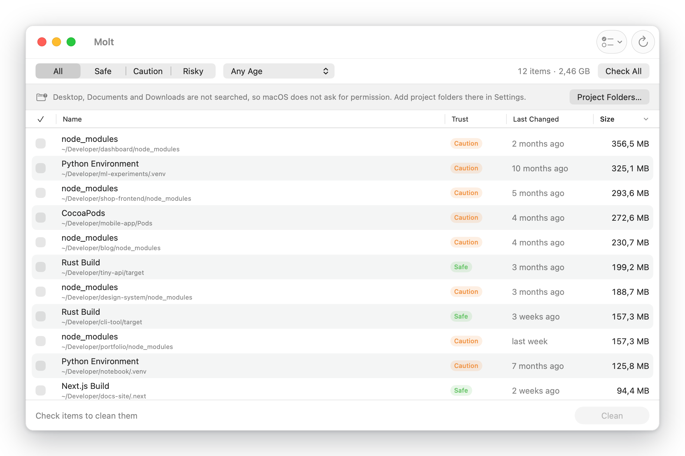
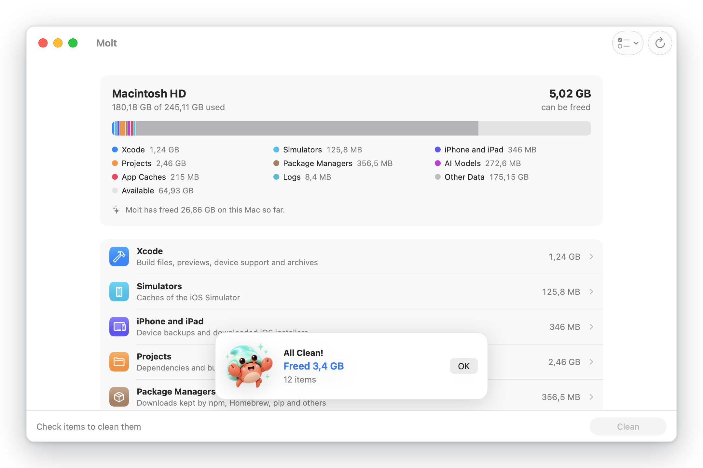

<p align="center">
  
</p>

<h1 align="center">Molt</h1>

<p align="center">
  <strong>Shed what your Mac no longer needs.</strong><br>
  A free, open source Mac app that clears the space developers lose to rebuildable files.
</p>

<p align="center">
  <a href="https://github.com/omerayyildiz/Molt/releases/latest/download/Molt.dmg"></a>
  <a href="https://molt.omerayyildiz.com"></a>
</p>

<p align="center">
  
  
  
</p>

<p align="center">
  
</p>

`node_modules`, Xcode build data, package caches and AI models pile up quietly, and macOS files them under
System Data. Molt finds them, explains each one and removes only what you choose.



## Why Molt

- **Explains every item.** What it is, how safe it is to remove, and how it comes back. Nothing is checked until you
  check it.
- **Only rebuildable files.** Molt knows a fixed list of cleanup rules and touches nothing else: no documents, photos,
  settings, mail or iCloud files.
- **Safe by design.** Every item is checked again right before removal. Files that do not come back go to the Trash.
  Molt never asks for an administrator password and never leaves your home folder.
- **Private.** No account, no analytics, no network access.
- **Open source.** Every rule is readable Swift code in [`Molt/Rules`](Molt/Rules).



## What Molt Cleans

| Group | Examples | Trust |
|---|---|---|
| Xcode | Derived Data, SwiftUI previews, device support, archives | Safe to risky |
| Simulators | Simulator caches | Safe |
| iPhone and iPad | Old iOS installers, device backups | Safe / risky |
| Projects | `node_modules`, `.next`, `target`, `.build`, `Pods`, `.venv`, Gradle `build` | Safe / caution |
| Package managers | npm, npx, Yarn, pnpm, Bun, Homebrew, pip, uv, Cargo, Gradle, CocoaPods | Safe |
| AI models | Ollama, LM Studio, Hugging Face | Caution |
| App caches and logs | `~/Library/Caches`, `~/Library/Logs` | Safe |

- **Safe:** comes back by itself or with the next build. Deleted.
- **Caution:** comes back by downloading or installing it again. Deleted.
- **Risky:** does not come back. Moved to the Trash, never deleted.

Projects in Desktop, Documents and Downloads are searched only after you add them in Settings, so macOS never surprises
you with permission prompts.



## Download

| | Direct download | Mac App Store |
|---|---|---|
| Price | Free | $2.99, to support the project |
| Sandbox | No | Yes |
| Covers | Every rule | Rules that only need files; asks once for your home folder |

**[Download Molt.dmg](https://github.com/omerayyildiz/Molt/releases/latest/download/Molt.dmg)**, open it and drag
Molt to Applications.

The App Store version runs in Apple's sandbox, which hides most other apps' caches and cannot run tools such as
`xcrun simctl`. Buying it is a way to support Molt; the free download does more.

## Building

Requirements: Xcode 27 or later to build. The app runs on macOS 15 or later.

```bash
open Molt.xcodeproj
```

Choose the **Molt** scheme for the direct build or **Molt App Store** for the sandboxed one.

Run the tests (they never launch the app or touch your real home folder):

```bash
swift test --scratch-path "$TMPDIR/molt-build"
```

Release tools live in [`scripts`](scripts): `release-dmg.sh` builds, notarizes and publishes the DMG,
`upload-app-store.sh` sends the App Store build to App Store Connect, `screenshots.sh` saves the screens above
from a made-up home folder, and `frame-images.py` frames them for this page and the website.

## Contributing

New cleanup rules are the most useful contribution. See [CONTRIBUTING.md](CONTRIBUTING.md).

## License

Molt is free software under the [GNU General Public License v3.0](LICENSE). The name "Molt", the app icon and the
hermit crab mascot are not covered by the license; forks need their own name and artwork.
